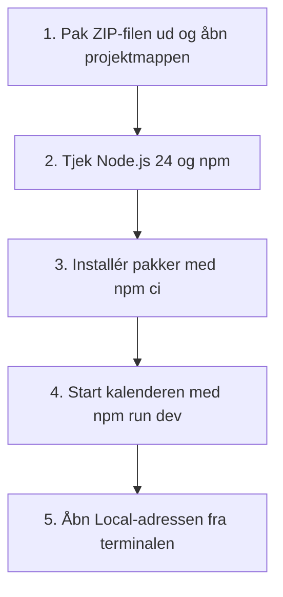

# Ringsted Duns julekalender 2026

En digital julekalender med 24 låger inspireret af H.C. Andersens eventyr. Bag lågerne finder du blandt andet quizzer, gåder og søvntips. Projektet bruger React, TypeScript, Vite og SCSS. Kalenderens indhold indlæses fra JSON.

## Lokal opsætning



Åbn en terminal i mappen, hvor `package.json` ligger. Kør kommandoerne i denne rækkefølge:

```bash
node --version
npm --version
npm ci
npm run dev
```

Projektet er testet med **Node.js 24**. Åbn den adresse, der står ud for **Local** i terminalen, typisk `http://localhost:5173/`. Lad terminalen køre, mens du bruger siden. Tryk **Ctrl+C** i terminalen for at stoppe serveren.

## Test lågerne før december

Kalenderen bruger datoen i København. Før 1. december 2026 er alle låger låst. Du kan vælge en testdato ved midlertidigt at erstatte linjen med `export function getCalendarDay` i [`src/utils/calendarProgress.ts`](src/utils/calendarProgress.ts) med:

```ts
export function getCalendarDay(date = new Date('2026-12-05T12:00:00+01:00')): number {
```

Gem filen og genindlæs siden. Låge 1–5 kan nu åbnes, og låge 6–24 er låst. Åbn låge 1, vælg **En paraply**, og tryk **Send svar**. Genindlæs siden for at se, om lågen stadig er markeret som åbnet. Fremgangen gemmes i browseren, så brug gerne et privat vindue til testen. Skift tilbage til `date = new Date()` bagefter.

## Produktion

```bash
npm run build
npm run preview
```

`npm run build` kontrollerer TypeScript og bygger projektet i `dist/`. `npm run preview` viser det færdige build lokalt.

## Find rundt i projektet

| Fil eller mappe                                                  | Indhold                                              |
| ---------------------------------------------------------------- | ---------------------------------------------------- |
| [`public/data/doors.json`](public/data/doors.json)               | Tekster, aktiviteter og gaver for alle 24 låger      |
| [`src/api/loadDoors.ts`](src/api/loadDoors.ts)                   | Indlæsning af kalenderens JSON-data                  |
| [`src/types/calendar.ts`](src/types/calendar.ts)                 | TypeScript-typer for låger og gaver                  |
| [`src/components/`](src/components/)                             | React-komponenter til kalenderen, lågerne og gaverne |
| [`src/utils/calendarProgress.ts`](src/utils/calendarProgress.ts) | Dato, åbning af låger og gemt fremgang               |
| [`src/styles/`](src/styles/)                                     | Layout og farver i SCSS                              |

Den grønne gaveknap er en del af prototypen. Den er deaktiveret, da materialet til gavehandlingerne endnu ikke er klar.
